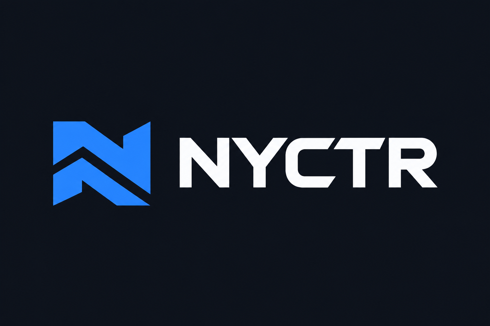
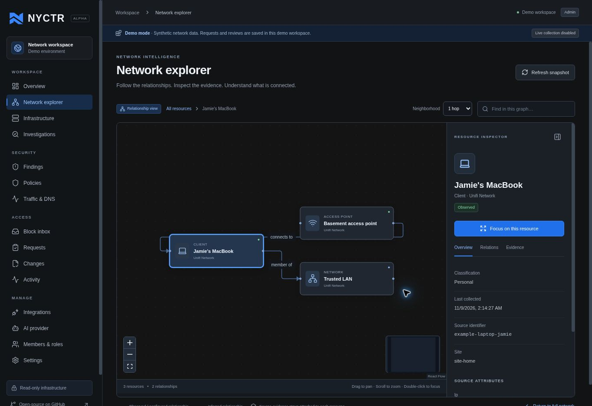
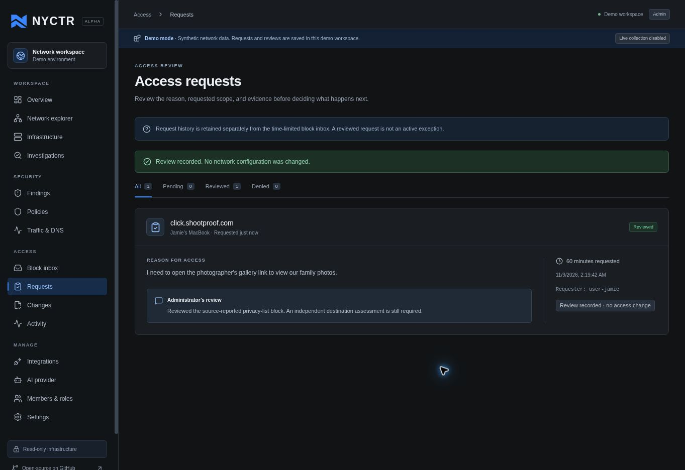

<p align="center">
  
</p>

<p align="center"><strong>Understand your network. Know what governs it.</strong></p>

<p align="center">
  <a href="https://github.com/homelab-0/nyctr/actions/workflows/ci.yml">CI</a> ·
  <a href="#quick-start">Quick start</a> ·
  <a href="docs/architecture/overview.md">Architecture</a> ·
  <a href="docs/roadmap.md">Roadmap</a> ·
  <a href="CONTRIBUTING.md">Contributing</a> ·
  <a href="SECURITY.md">Security</a>
</p>

# Nyctr

**Nyctr** (pronounced *nick-ter*) is a self-hosted, open-source network security
workspace. It brings devices, networks, workloads, DNS controls, firewall policies,
and security observations into a connected view so administrators can understand
what is happening, why access is blocked, and where a change belongs.

The product is built around evidence: what a provider reports, what its
configuration permits, what traffic was actually observed, and what remains
unknown. Interactive graphs connect those layers without treating a physical
connection as proof of successful network access.

Nyctr is designed for homelabs, small teams, and administrators managing mixed
infrastructure. Integrations are adapters to a shared model. UniFi and NextDNS are
the first targets; the architecture leaves room for hypervisor and cloud controls.

> **Status: early alpha, unreleased.** This repository contains the first working
> application foundation. Infrastructure connectors are read only. Access requests
> are recorded for review; this version cannot unblock a domain or change a firewall.
> The capability table below distinguishes implemented behavior from the roadmap.

## Why Nyctr?

A failed connection can involve a DNS blocklist, a network firewall, a hypervisor
rule, an inherited policy, or missing routing. Those controls often live in
different consoles. Nyctr's goal is to connect the evidence and explain which
control matters, while keeping the administrator in charge of changes.

The member portal applies the same idea to everyday access problems. People can
sign in, see recent blocks associated with their assigned devices, and submit a
request with a reason. A washing machine's telemetry, an unattributed DNS query,
and another person's browsing activity do not become a member's inbox entries.

## In the application

Drill into a resource and inspect the relationships and evidence around it:



Member requests enter a persistent review workflow with explicit outcomes:



These screenshots show the running application with synthetic demonstration data.

## Current capabilities

| Area | Initial implementation | Next stages |
| --- | --- | --- |
| Workspace | Branded React interface, overview, inventory, integrations, audit | Saved investigations, richer search, multiple workspaces |
| Network explorer | Interactive graph, resource inspector, focused neighborhoods, finding context | Large-graph layouts, temporal comparison, path simulation |
| Identity | Local accounts, cookie sessions, administrator/member roles, optional OIDC | Account administration, richer role and group policies |
| Evidence | Persistent resources, typed relationships, observations and source timestamps | Historical snapshots, drift and coverage analysis |
| UniFi Network | Read-only inventory and configured-policy adapter | Port posture, event receiver, broader policy analysis |
| NextDNS | Read-only profile and blocked-query adapter | Stronger endpoint attribution and policy evaluation |
| Member portal | Authorized recent blocks, assigned devices, persistent requests | Background risk evaluation and temporary access |
| Change handling | Internal request review and audit; no provider write operations | Exact-plan approval, isolated execution, verification and expiry |
| AI | Architectural boundary documented; no model called in this version | BYO provider through LiteLLM/Spektr, evidence-backed explanations |
| Packaging | One application Dockerfile, PostgreSQL Compose setup, CI | Published images, Helm chart, signed releases and upgrade tooling |

Synthetic findings in demo mode demonstrate the workflow. The initial live
collectors do not constitute a complete reachability engine or vulnerability scan.
An absent event or an unknown block reason is not evidence that a destination is
safe. See [the security model](docs/security-model.md).

## Quick start

Requires Docker with the Compose plugin. The quick start is an **explicit demo**:
it uses synthetic data, known demonstration accounts, and cannot connect to live
infrastructure. The web port binds to localhost.

```sh
git clone https://github.com/homelab-0/nyctr.git
cd nyctr
docker compose up --build -d
```

Open **http://localhost:8080**. Use the demo sign-in buttons, or:

| Role | Email | Password |
| --- | --- | --- |
| Administrator | `admin@nyctr.demo` | `nyctr-demo` |
| Member | `jamie@nyctr.demo` | `nyctr-demo` |

Try selecting a device in the explorer, opening a finding's graph, signing in as
the member, and submitting a request from a recent block. Requests and audit
records persist in PostgreSQL across application restarts. Reviewing a request
does **not** grant access in this release.

```sh
docker compose logs -f nyctr
docker compose down
```

`down` preserves the database volume. Removing that volume deletes the local demo
database; do not reuse a demo database for a live installation.

## Running with real integrations

Use a **new database** and live-mode configuration. The application defaults to
live mode when run directly; the quick-start Compose file explicitly selects
demo mode. Live mode never creates the demonstration accounts or sample topology.

1. Copy `.env.production.example` to `.env.production` and set the database
   password, initial administrator credentials, public HTTPS URL, and the actual
   reverse-proxy peer addresses in `FORWARDED_ALLOW_IPS`.
2. Place Nyctr behind your HTTPS ingress or reverse proxy.
3. Start the production Compose override:

```sh
docker compose --env-file .env.production \
  -f compose.yaml -f deploy/compose/compose.production.yaml \
  up --build -d
```

Configure provider credentials as environment secrets with the prefix
`NYCTR_CONNECTOR_SECRET_`. Integrations store only the reference name, never the
credential value. For example, an administrator can reference
`NYCTR_CONNECTOR_SECRET_UNIFI` when adding a UniFi integration. Explicitly allow
the UniFi console's HTTPS hostname using `NYCTR_CONNECTOR_HOSTS`.

The application's connector code only sends GET requests. Use the narrowest
provider-side permissions available for the selected API; the application cannot
make an unrestricted provider key read only at the provider itself.

Read [deployment](deploy/README.md), [integration setup](docs/integrations.md), and
[authentication configuration](services/api/README.md) before collecting real data.
No live integration has been validated against the maintainer's network as part
of the initial implementation; tests use synthetic provider responses.

## Architecture

Nyctr starts as a modular application with one API and one relational database.
There is no requirement to operate a graph database, message broker, or model
server to try it.

| Component | Technology and responsibility |
| --- | --- |
| Web application | React, TypeScript, Vite; interactive graph with React Flow |
| API | Python, FastAPI; authentication, authorization and application workflows |
| Persistence | SQLAlchemy; PostgreSQL for deployment, SQLite for isolated tests |
| Adapters | Provider-specific collection and normalization behind a GET-only boundary |
| Distribution | Node build stage plus non-root Python runtime in one Docker image |

The web application calls a same-origin API. Provider credentials stay on the
server. Server-side authorization scopes every member request; hiding a button
in the UI is not an access control.

```text
apps/web/                 Web interface and design system
services/api/nyctr/       API, authentication, model and integration adapters
services/api/tests/       Authorization, data and provider contract tests
deploy/                  Container and deployment instructions
docs/                    Architecture, integrations, roadmap and security model
.github/                 CI, issue forms and pull-request guidance
```

See [architecture](docs/architecture/overview.md) for the boundaries between
collection, evidence, analysis, authorization, and eventual execution.

## Development

Requires Python 3.12+ and Node.js 24. Run the API and web dev server in separate
terminals:

```sh
python3 -m venv .venv
. .venv/bin/activate
python -m pip install -e './services/api[dev]'
NYCTR_MODE=demo NYCTR_DATABASE_URL=sqlite:///./nyctr-demo.db \
  NYCTR_PUBLIC_URL=http://localhost:5173 \
  uvicorn nyctr.main:app --host 127.0.0.1 --port 8000 --reload
```

```sh
cd apps/web
npm ci
npm run dev -- --host 127.0.0.1
```

The web development server proxies `/api` to the local API. Visit
http://localhost:5173. Interactive API documentation is available at
http://localhost:8000/api/docs during development.

### Verification

```sh
python -m pytest services/api/tests
npm --prefix apps/web test
npm --prefix apps/web run build
docker build -t nyctr:dev .
```

CI runs the backend checks, frontend build, and container integration smoke test.
The container smoke test exercises the built application with PostgreSQL.

## Design principles

- **Evidence before explanation.** Keep observed, configured and inferred facts
  distinct, with source and collection time attached.
- **Read only by default.** Collection and analysis do not carry authority to
  change infrastructure.
- **People retain control.** Future writes must match an authorized, bounded plan.
  A model recommendation cannot grant itself permission.
- **Privacy in the member portal.** Device ownership, event-time attribution,
  freshness and current authorization govern visibility.
- **Vendor neutrality.** Keep provider behavior in adapters and expose capability
  gaps honestly. Site Manager belongs under UniFi Fabric in the product while
  remaining a distinct API connection.
- **Self-hosting first.** Core operation does not depend on a hosted Nyctr service
  or an AI subscription.

## Roadmap and participation

The [roadmap](docs/roadmap.md) covers network and port posture, firewall/DNS
analysis, cloud and hypervisor integrations, AI, the external MCP interface,
member self-service, and controlled remediation. It is sequenced by dependencies,
not a promise that every listed feature already exists.

Contributions are welcome. Start with [CONTRIBUTING.md](CONTRIBUTING.md), follow
the [Code of Conduct](CODE_OF_CONDUCT.md), and use the issue forms for bugs and
feature proposals. Report vulnerabilities using [SECURITY.md](SECURITY.md).

## License

Nyctr's source code is licensed under [Apache-2.0](LICENSE). Third-party product
names and marks belong to their respective owners. Nyctr is an independent project
and is not affiliated with the vendors it integrates with.
