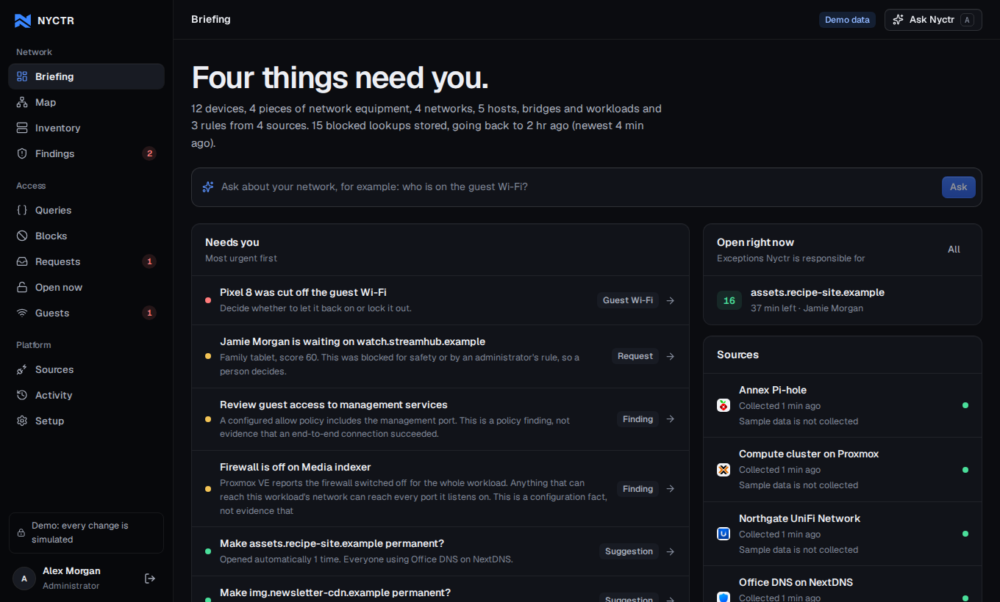
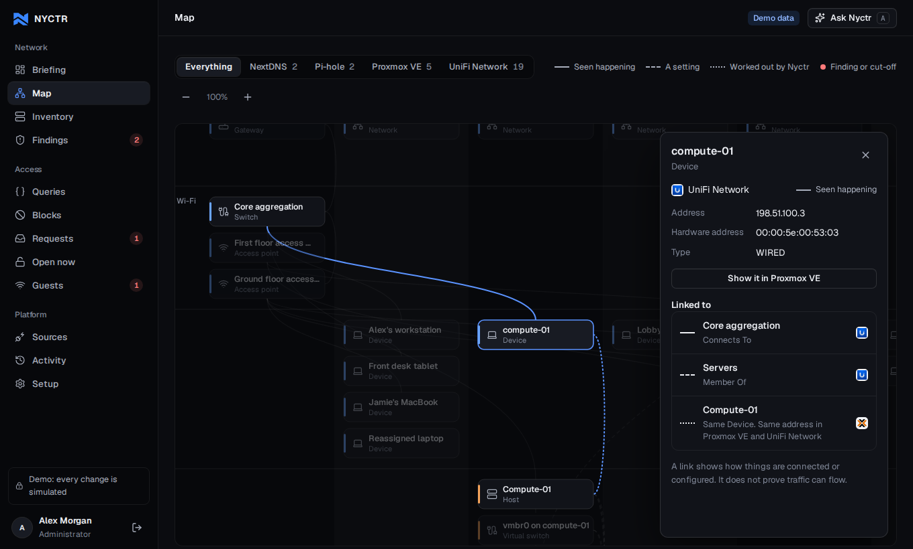
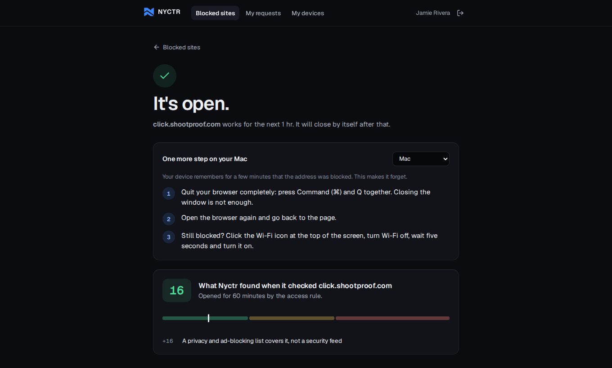

<p align="center">
  
</p>

<p align="center"><strong>Understand your network. Know what governs it.</strong></p>

<p align="center">
  <a href="https://github.com/homelab-0/nyctr/actions/workflows/ci.yml">CI</a> ·
  <a href="#quick-start">Quick start</a> ·
  <a href="docs/architecture/overview.md">Architecture</a> ·
  <a href="docs/roadmap.md">Roadmap</a> ·
  <a href="CONTRIBUTING.md">Contributing</a> ·
  <a href="SECURITY.md">Security</a>
</p>

# Nyctr

**Nyctr** (pronounced *nick-ter*) is a self-hosted, open-source network security
workspace. It brings devices, networks, workloads, DNS controls, firewall policies,
and security observations into a connected view so administrators can understand
what is happening, why access is blocked, and where a change belongs.

The product is built around evidence: what a provider reports, what its
configuration permits, what traffic was actually observed, and what remains
unknown. Interactive graphs connect those layers without treating a physical
connection as proof of successful network access.

Nyctr is its own product, not a front end for one vendor. Its features (the map,
blocks and requests, temporary access, guest Wi-Fi) are written against
capabilities such as "reports blocked lookups" or "can issue a guest pass". An
integration declares which capabilities its source offers, and a feature works
once a connected source offers it. UniFi Network, NextDNS, Proxmox VE and Pi-hole
are the integrations in this build; adding another is one module and no change to
the core or the console ([contract](docs/integration-contract.md)).

> **Status: early alpha.** An image exists only for a completed
> [GitHub Release](https://github.com/homelab-0/nyctr/releases); if none is
> listed, build from source. Collection is read only. Nyctr can change a
> source in exactly three ways (open or close a DNS exception, issue or end a
> guest pass, let a guest device on or take its access away), only at a source
> whose integration offers it, and only when an operator names that integration in
> `NYCTR_PROVIDER_WRITES`. It is off by default. Nothing here has been run against
> real UniFi, NextDNS, Proxmox or Pi-hole systems; tests use synthetic provider
> responses. The capability table below
> separates what is implemented, simulated in demo, experimental and planned.

## Why Nyctr?

A failed connection can involve a DNS blocklist, a network firewall, a hypervisor
rule, an inherited policy, or missing routing. Those controls often live in
different consoles. Nyctr's goal is to connect the evidence and explain which
control matters, while keeping the administrator in charge of changes.

The member portal applies the same idea to everyday access problems. People sign
in, see what was blocked on the device in their hand, read a plain reason and a
risk score, and ask for it to be opened. A low-risk privacy-list block can open
for a limited time under a rule the administrator wrote; anything else waits for
a person. A washing machine's telemetry, an unattributed DNS query, and another
person's browsing activity do not become a member's inbox entries.

## In the application

The briefing ranks what needs a person, using fixed rules rather than a model:



The map puts each network in a column and each layer in a row. Line style shows
whether a link was observed, configured or inferred by Nyctr:



A member sees the score, what it is based on, and how to reconnect once it opens:



These screenshots show the running application with synthetic demonstration data.

## Current capabilities

| Area | In this build | Status | Next |
| --- | --- | --- | --- |
| Console | Briefing, map, inventory, findings, blocks, requests, open access, guests, sources, activity, setup | Implemented | Saved views, multiple workspaces |
| Integration contract | Each integration declares what it reads, which capabilities it adds and what it can change; the core and console hold no vendor names, enforced by tests | Implemented | Out-of-tree integrations |
| Network map | Column per network, row per layer; one view per kind of source; follow a network device into the source that hosts it | Implemented; layout tested to a 40-device cell, not at enterprise scale | Temporal comparison, path simulation |
| Identity | Local accounts, cookie sessions, administrator and member roles, optional OIDC | Implemented | Account administration, group policies |
| Evidence | Resources, typed relationships and observations, each marked observed, configured or inferred | Implemented | Historical snapshots, drift |
| Risk score | Rule-based score from the stored block reason, explained by the source's own integration, and the shape of the name; unknown stays unknown | Implemented. It is not a reputation lookup | Background investigation with source links |
| Access rule and leases | Administrator-written rule may open a low-risk privacy-list block at a source that offers it; durable leases; expiry and restart reconciliation; suggestions for permanent exceptions | Implemented; simulated in demo; real NextDNS writes untested | Exact-plan approval binding, drift checks |
| Member portal | Blocks on the device in hand, score and factors, one request form, reconnect steps per device type | Implemented. Device recognition needs the member's LAN address to reach Nyctr | Push or email when a person decides |
| Guest Wi-Fi | Guests sign in on the network's own portal (UniFi today); Nyctr issues passes, lets a waiting device on, shows who is on, access point history, data use and blocked lookups, and can cut off, restore or lock out, by hand or under a counted rule ([design](docs/guest-wifi.md)) | Implemented; simulated in demo; real UniFi writes untested | Firewall log receiver, UniFi-side block rule |
| UniFi Network | Read-only inventory, policies, guest access state and vouchers; diagnostics | Implemented against the 11.0.97 contract | Ports, event receiver, policy analysis |
| NextDNS | Read-only profile and blocked lookups with reason codes; administrator device-label links | Implemented | Incremental collection |
| Proxmox VE | Read-only nodes, bridges, guests, network cards and firewall switches | Experimental; never run against a cluster | Firewall rules, SDN |
| Pi-hole | Read-only blocked lookups from a Pi-hole v6 resolver with its client labels. Reports blocks; does not open them, so its requests always wait for a person | Experimental; sign-in follows the published contract, query-log fields unverified against a live Pi-hole | Opening an address, list names |
| Graph queries | Read-only GraphQL endpoint with length, depth and result limits; schema browser | Implemented | Saved queries, pagination |
| Assistant | Attention list (rules only); questions and finding insights through an OpenAI-compatible endpoint you configure | Implemented. Demo without a model returns labelled sample answers; live without a model is off | External MCP read tools |
| Packaging | Dockerfile, PostgreSQL Compose, Helm chart, acceptance stack, release workflow | Implemented. The release workflow publishes images from `v0.1.0-alpha.1` and the chart from `v0.1.0-alpha.2` | Upgrade tooling |

Synthetic findings in demo mode demonstrate the workflow. The initial live
collectors do not constitute a complete reachability engine or vulnerability scan.
An absent event or an unknown block reason is not evidence that a destination is
safe. See [the security model](docs/security-model.md).

## Quick start

Requires Docker with the Compose plugin. The quick start is an **explicit demo**:
it uses synthetic data, known demonstration accounts, and cannot connect to live
infrastructure. The web port binds to localhost.

```sh
git clone https://github.com/homelab-0/nyctr.git
cd nyctr
docker compose up --build -d
```

Open **http://localhost:8080**. Use the demo sign-in buttons, or:

| Role | Email | Password |
| --- | --- | --- |
| Administrator | `admin@nyctr.demo` | `nyctr-demo` |
| Member | `jamie@nyctr.demo` | `nyctr-demo` |

Try selecting a device in the explorer, opening a finding's graph, signing in as
the member, and submitting a request from a recent block. Requests and audit
records persist in PostgreSQL across application restarts. The demo never
contacts a provider. Approving a request about a source that can open addresses
records a simulated lease; for a source that cannot, such as the demo's Pi-hole,
the lease is recorded as not applied.

```sh
docker compose logs -f nyctr
docker compose down
```

`down` preserves the database volume. Removing that volume deletes the local demo
database; do not reuse a demo database for a live installation.

## Running with real integrations

Use a **new database** and live-mode configuration. The application defaults to
live mode when run directly; the quick-start Compose file explicitly selects
demo mode. Live mode never creates the demonstration accounts or sample topology.

1. Copy `.env.production.example` to `.env.production` and set the database
   password, initial administrator credentials, public HTTPS URL, and the actual
   reverse-proxy peer addresses in `FORWARDED_ALLOW_IPS`.
2. Place Nyctr behind your HTTPS ingress or reverse proxy.
3. Start the production Compose override:

```sh
docker compose --env-file .env.production \
  -f compose.yaml -f deploy/compose/compose.production.yaml \
  up --build -d
```

Configure provider credentials as environment secrets with the prefix
`NYCTR_CONNECTOR_SECRET_`. Integrations store only the reference name, never the
credential value. For example, an administrator can reference
`NYCTR_CONNECTOR_SECRET_UNIFI` when adding a UniFi integration. Explicitly allow
the UniFi console's HTTPS hostname using `NYCTR_CONNECTOR_HOSTS`.

Collection only reads. Changes are a separate code path that refuses to run
unless the integration is named in `NYCTR_PROVIDER_WRITES`, and only integrations
that can change their source are accepted there (today `nextdns` and
`unifi_network`; the Sources page shows what each one could change):

| Setting | Effect |
| --- | --- |
| `NYCTR_PROVIDER_WRITES=nextdns` | The access rule and approvals may add and later remove a NextDNS allowlist entry. An exception applies to the whole profile, and the console says so before approval. |
| `NYCTR_PROVIDER_WRITES=unifi_network` | Administrators may issue and end guest passes and cut off, restore or lock out a guest device; the cut-off rule may unauthorise a guest. |
| `NYCTR_COLLECT_INTERVAL_SECONDS=300` | Collect every five minutes. Without it, collection happens only when an administrator presses Collect, so the cut-off rule only runs then. |
| `NYCTR_NUDGE_TOKEN=<32+ characters>` | Lets the UniFi console call `/api/hooks/collect/<token>` (for example from an Alarm Manager webhook) so Nyctr collects straight away when a client connects. |
| `NYCTR_AI_BASE_URL`, `NYCTR_AI_MODEL`, `NYCTR_AI_API_KEY` | An OpenAI-compatible chat endpoint for the assistant, such as a LiteLLM proxy. The model receives a bounded, redacted evidence pack and no credentials. |

Leave `NYCTR_PROVIDER_WRITES` empty to keep every source read only; requests are
still scored and shown, and approvals are recorded as not applied. Use the
narrowest provider-side permissions available; Nyctr cannot make an unrestricted
provider key read only at the provider itself.

Use **Run diagnostics** on a saved integration to check configuration, credentials,
verified HTTPS reads, supported response shapes, and evidence gaps. Results
distinguish implemented adapter capabilities from reads verified in that check.
Diagnostics do not import the examined inventory or refresh collection health;
**Collect snapshot** is a separate action. A successful connection does not prove
firewall-event coverage, user attribution, end-to-end access, or a safe destination.

Read [deployment](deploy/README.md), [integration setup](docs/integrations.md), and
[authentication configuration](services/api/README.md) before collecting real data.
No live integration has been validated against the maintainer's network as part
of the initial implementation; tests use synthetic provider responses.

## Deployment packages and independent testing

The [Helm chart](charts/nyctr/README.md) supports an existing PostgreSQL database,
Secret references, OIDC, and optional Ingress or Gateway API routing. It keeps
one application replica during alpha and validates explicit live-mode settings.
It does not provision an identity provider or a production database for you.

The [release workflow](docs/releases.md) validates a tagged source version before
publishing AMD64/ARM64 images with SBOM and provenance metadata, followed by the
Helm chart under the same version. A workflow in the repository is not proof
that a release image has been published: use only a completed release's
recorded image digest. The source-build quick start above
works before the first published image.

For independent testing, use the [Cloudex acceptance handoff](docs/testing/cloudex.md).
It covers a fresh Docker install, browser workflows, application restarts, and
an [isolated provider fixture stack](tests/acceptance/README.md). Synthetic UniFi
and NextDNS HTTPS endpoints run inside an internal Docker network; no homelab
route, production credential, or real browsing history is required.

## Architecture

Nyctr starts as a modular application with one API and one relational database.
There is no requirement to operate a graph database, message broker, or model
server to try it.

| Component | Technology and responsibility |
| --- | --- |
| Web application | React, TypeScript, Vite; SVG network map with a small deterministic layout |
| API | Python, FastAPI; authentication, authorization and application workflows |
| Persistence | SQLAlchemy; PostgreSQL for deployment, SQLite for isolated tests |
| Integrations | One module per kind of source behind a declared contract: read-only collection, the capabilities it adds, and gated changes isolated in one module. The core and the console name no vendor |
| Queries | graphql-core; read-only schema over stored evidence |
| Distribution | Node build stage plus non-root Python runtime in one Docker image |

The web application calls a same-origin API. Provider credentials stay on the
server. Server-side authorization scopes every member request; hiding a button
in the UI is not an access control.

```text
apps/web/                 Web interface and design system
services/api/nyctr/       API, authentication, model and integration adapters
services/api/tests/       Authorization, data and provider contract tests
deploy/                  Container and deployment instructions
docs/                    Architecture, integrations, roadmap and security model
.github/                 CI, issue forms and pull-request guidance
```

See [architecture](docs/architecture/overview.md) for the boundaries between
collection, evidence, analysis, authorization, and eventual execution.

## Development

Requires Python 3.12+ and Node.js 24. Run the API and web dev server in separate
terminals:

```sh
python3 -m venv .venv
. .venv/bin/activate
python -m pip install -e './services/api[dev]'
NYCTR_MODE=demo NYCTR_DATABASE_URL=sqlite:///./nyctr-demo.db \
  NYCTR_PUBLIC_URL=http://localhost:5173 \
  uvicorn nyctr.main:app --host 127.0.0.1 --port 8000 --reload
```

```sh
cd apps/web
npm ci
npm run dev -- --host 127.0.0.1
```

The web development server proxies `/api` to the local API. Visit
http://localhost:5173. Interactive API documentation is available at
http://localhost:8000/api/docs during development.

### Verification

```sh
python -m pytest services/api/tests
npm --prefix apps/web test
npm --prefix apps/web run build
docker build -t nyctr:dev .
```

CI runs the backend checks, frontend build, and container integration smoke test.
Container smoke tests exercise the built application with PostgreSQL on AMD64 and
ARM64. Helm rendering checks and an isolated Kubernetes installation exercise the
chart separately. Provider acceptance tests check real HTTPS exchanges with local
synthetic servers, not vendor infrastructure. See [testing](docs/testing/cloudex.md)
for commands and the distinction between automated coverage and browser review.

## Design principles

- **Evidence before explanation.** Keep observed, configured and inferred facts
  distinct, with source and collection time attached.
- **Read only by default.** Collection and analysis never change infrastructure.
  The few changes Nyctr can make are off until an operator allows each provider.
- **People retain control.** Nyctr acts on its own only under a rule an
  administrator wrote, within bounds the code enforces. A model cannot trigger a
  change, edit a rule or grant itself permission.
- **Privacy in the member portal.** Device ownership, event-time attribution,
  freshness and current authorization govern visibility.
- **Vendor neutrality.** Keep provider behavior in adapters and expose capability
  gaps honestly. Site Manager belongs under UniFi Fabric in the product while
  remaining a distinct API connection.
- **Self-hosting first.** Core operation does not depend on a hosted Nyctr service
  or an AI subscription.

## Roadmap and participation

The [roadmap](docs/roadmap.md) covers network and port posture, firewall/DNS
analysis, cloud and hypervisor integrations, AI, the external MCP interface,
member self-service, and controlled remediation. It is sequenced by dependencies,
not a promise that every listed feature already exists.

Contributions are welcome. Start with [CONTRIBUTING.md](CONTRIBUTING.md), follow
the [Code of Conduct](CODE_OF_CONDUCT.md), and use the issue forms for bugs and
feature proposals. Report vulnerabilities using [SECURITY.md](SECURITY.md).

## License

Nyctr's source code is licensed under [Apache-2.0](LICENSE). Third-party product
names and marks belong to their respective owners. Nyctr is an independent project
and is not affiliated with the vendors it integrates with.
